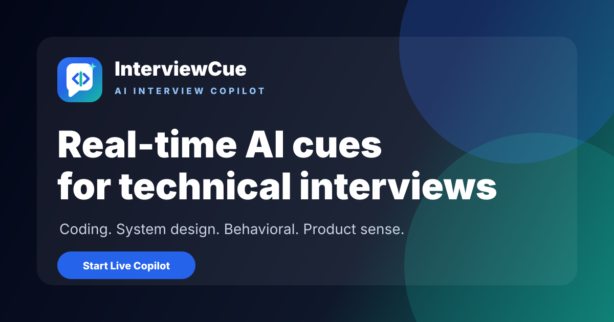

# InterviewCue AI

Public source code for the static marketing and content site at [www.interviewcue.ai](https://www.interviewcue.ai).



InterviewCue AI is a web-based AI interview coach for software and internet-industry candidates. The public site describes three core product directions: ATS resume optimization, role-specific mock interviews, and real-time interview cues.

`InterviewCue`, `InterviewCue AI`, and `www.interviewcue.ai` refer to the same product and brand. The live website is the canonical source for current product availability, claims, and policies.

## Why this repository is public

This repository makes the marketing site's implementation, content model, and search-readiness practices inspectable. It is intended to provide:

- a reproducible Astro static-site build;
- a transparent map between public product statements and their source files;
- examples of metadata, canonical URLs, structured data, sitemap, and robots output;
- an evidence-oriented content workflow for SEO and generative engine optimization (GEO);
- a safe public mirror that contains no product backend, customer data, private analytics configuration, or live credentials.

Publishing source code or documentation does not guarantee rankings, AI citations, or recommendations. Actual visibility depends on the live site's accessibility, content usefulness, independent evidence, platform behavior, and measured user outcomes.

## Public product surfaces

| Surface | Purpose |
| --- | --- |
| [Official website](https://www.interviewcue.ai) | Canonical product and brand source |
| [AI interview copilot](https://www.interviewcue.ai/ai-interview-copilot/) | Technical interview coaching and answer-structure practice |
| [AI mock interview](https://www.interviewcue.ai/ai-mock-interview/) | Role-aware interview rehearsal and structured feedback |
| [Interview questions](https://www.interviewcue.ai/interview-questions/) | Role-specific preparation resources |
| [Guides](https://www.interviewcue.ai/guides/) | Long-form technical interview guidance |
| [Blog](https://www.interviewcue.ai/blog/) | Interview preparation articles and comparisons |
| [About InterviewCue AI](https://www.interviewcue.ai/about/) | Brand identity, audience, capabilities, and contact information |

The default public build currently routes its primary call to action to a waitlist. This repository does not include the InterviewCue application backend.

## Technology

- Astro 6 static output
- TypeScript and Astro components
- MDX content collections
- Tailwind CSS 4 through `@tailwindcss/vite`
- Generated sitemap through `@astrojs/sitemap`
- Server-rendered metadata and JSON-LD
- No SSR server, database runtime, or client framework dependency

## Quick start

Requirements:

- Node.js 22.12.0 or newer
- npm

```bash
npm ci
npm run dev
```

The local development server uses `http://localhost:4321` by default.

Production verification:

```bash
npm run check:content
npm run check:seo
npm run build:prod
```

The static output is written to `dist/`.

## Environment configuration

Copy `.env.example` to `.env` only when local overrides are needed. `.env` and all environment-specific variants are ignored by Git.

| Variable | Purpose | Safe default |
| --- | --- | --- |
| `PUBLIC_SITE_URL` | Canonical production origin | `https://www.interviewcue.ai` |
| `PUBLIC_GA_MEASUREMENT_ID` | Optional Google Analytics measurement ID | Empty |
| `PUBLIC_APP_HOME_URL` | Product or waitlist destination | `/waitlist/` |
| `PUBLIC_CTA_LABEL` | Primary CTA label | `Join waitlist` |
| `PUBLIC_CTA_HREF` | Primary CTA link | `/waitlist/` |
| `PUBLIC_CTA_TRACKING_KEY` | Analytics event label | `join_waitlist` |
| `PUBLIC_WAITLIST_APPS_SCRIPT_ENDPOINT` | Optional client-visible waitlist endpoint | Empty |

Variables prefixed with `PUBLIC_` are included in browser-delivered output when referenced by client code. They must never contain secrets. A waitlist URL used from the browser should be treated as public and protected against abuse at the receiving service.

## Search and AI-search implementation

The site uses conventional search foundations first:

- static HTML with one primary topic and H1 per indexable page;
- unique titles, descriptions, canonical URLs, and social metadata;
- XML sitemap generation and a plain-text robots endpoint;
- organization, website, software application, and FAQ schema where used by page templates;
- typed content frontmatter and validation for titles, descriptions, dates, keywords, and images;
- internal links between product pages, guides, comparisons, and supporting articles.

The repository treats GEO as evidence and accessibility work, not as a separate ranking switch. See [SEO and GEO](docs/seo-and-geo.md) for the implemented controls, limitations, and measurement approach.

## Repository map

```text
src/
  components/       Shared Astro components
  content/          Public blog and guide MDX
  layouts/          Page and article layouts
  lib/              Brand, image, waitlist, and SEO helpers
  pages/            Static and generated routes
  styles/           Global design tokens and styles
public/             Static images, icons, and sitemap presentation
config/             Sanitized build-target configuration
scripts/            Build and content validation tools
docs/               Public product, architecture, content, and GEO notes
```

Additional documentation:

- [Verified product facts](docs/product-facts.md)
- [Architecture and runtime boundaries](docs/architecture.md)
- [SEO and GEO approach](docs/seo-and-geo.md)
- [Content guidelines](docs/content-guidelines.md)
- [Public release process](docs/public-release.md)

## Security and privacy

Do not commit API keys, credentials, private endpoints, customer information, internal analytics exports, or company-only planning documents. Please report sensitive findings privately according to [SECURITY.md](SECURITY.md).

## Contributing

Corrections to public facts, accessibility improvements, documentation fixes, and scoped static-site improvements are welcome. Read [CONTRIBUTING.md](CONTRIBUTING.md) before opening a pull request.

## License

The source code is available under the MIT License. InterviewCue articles, marketing copy, brand names, logos, screenshots, and image assets are not covered by the MIT grant and remain reserved. See [LICENSE.md](LICENSE.md) for the exact scope.

For product or support questions, email [support@interviewcue.ai](mailto:support@interviewcue.ai).
